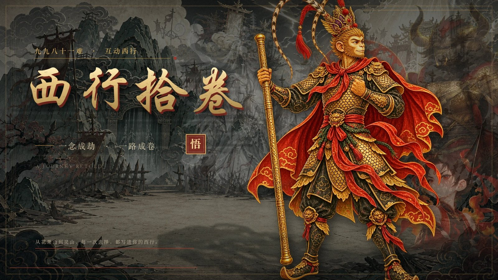
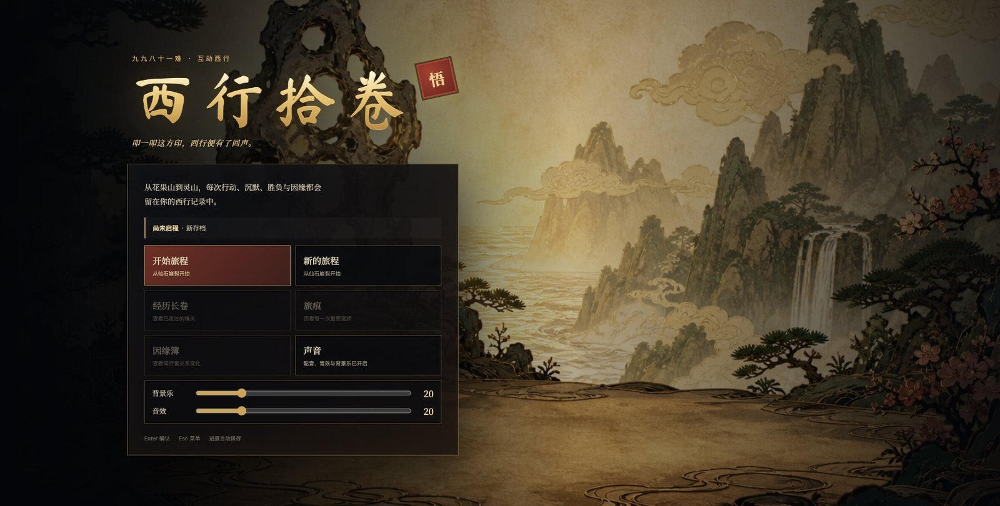
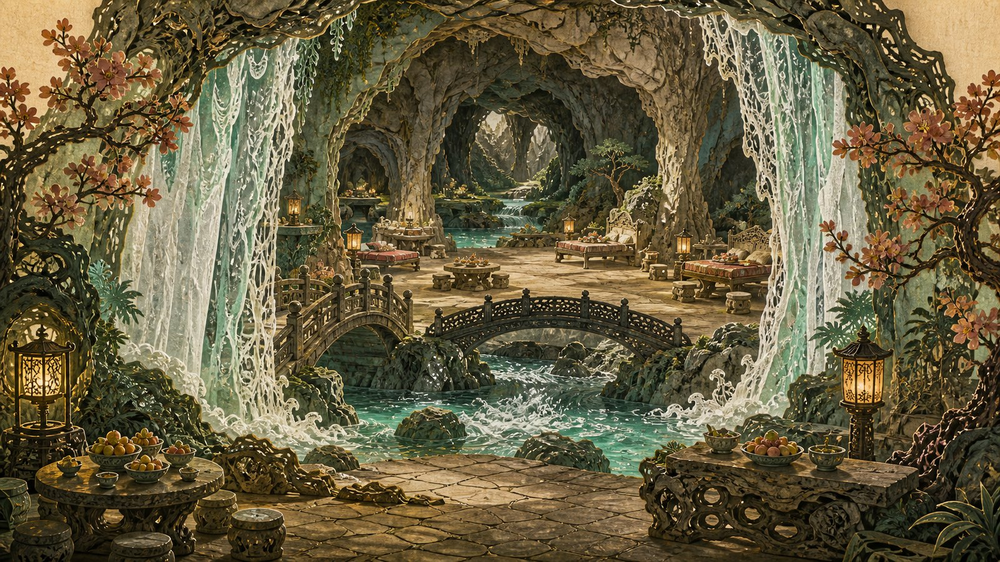

<p align="center">
  
</p>

<h1 align="center">西行拾卷</h1>

<p align="center">一部以皮影戏形式演出的《西游记》互动剧情游戏</p>

## 简介

玩家在桌面或平板浏览器中，用 15–30 分钟走完一轮取经路，在每一难做出抉择，塑造师徒关系与取经之志，最终抵达不同的结局。

## 玩法

- **互动图像小说**：每一难都是一次可读、可选、可回看后果的抉择，选择累积成可见的「旅痕」，影响师徒关系与结局。
- **皮影戏演出**：以剪影、光照与转场构成舞台，画面像一部会呼吸的连环画。
- **穿插小游戏**：部分关卡包含轻量互动小游戏。
- **可选语音**：内置语音适配层，可接入本地语音合成服务。

## 画面

<p align="center">
  
  
</p>
<p align="center">
  
</p>

## 技术栈

- 原生 HTML / CSS / JavaScript，经典脚本加载，无需构建、无第三方运行时依赖。
- 皮影戏演出由 CSS 与 DOM 驱动。

## 运行

在项目根目录启动一个静态服务器：

```bash
python3 -m http.server 8000
```

浏览器打开 http://localhost:8000/ 。

注意：必须通过 http 服务器访问；直接双击 `index.html`（`file://`）会因字体与素材加载限制导致异常。

## 可选：语音合成服务

游戏核心可无语音运行。若需要角色语音，安装 `edge-tts` 后运行本地服务：

```bash
pip install edge-tts
python3 voice_server.py
```

`voice-adapter.js` 会自动连接该服务。

## 目录结构

```
ToTheWest/
├── index.html              入口
├── shadowplay*.css/.js     皮影戏舞台、演出运行时与小游戏
├── game.js                 主逻辑
├── canonical-story.js      正史剧情
├── story-branches.js       分支剧情
├── story-data.js           剧情数据
├── voice-adapter.js        语音适配层
├── voice_server.py         可选本地语音服务
├── assets/                 音频、背景、角色、字体、小游戏、转场、UI、语音
├── docs/                   设计资料与画面截图
└── scripts/                素材与发布工具脚本
```

## 说明

- `assets/` 中的美术与音频素材是运行所必需。
- 版权与许可：作者保留所有权利（未声明开源协议）。
